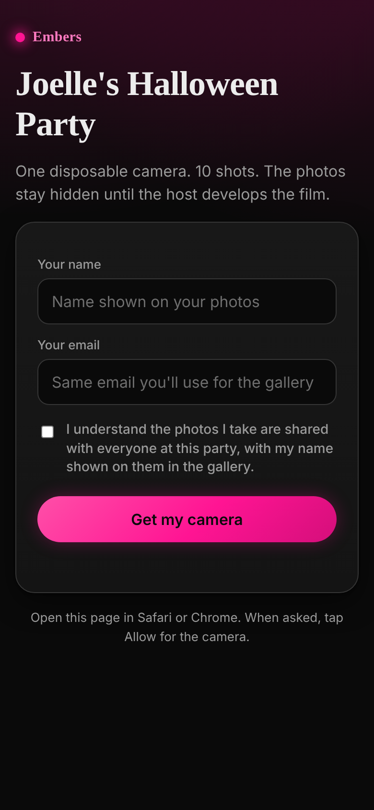
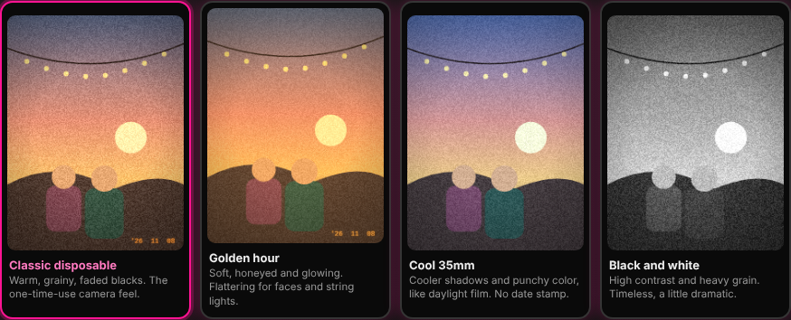

# Embers

**A disposable camera for your party, in the browser.** Guests tap a link, get 10 shots, and see nothing until the host develops the film. Then everyone gets one shared gallery.

> A personal project by Joelle Liu, built with Claude as an MVP.

**Links**
- Live app: [embers-umber.vercel.app](https://embers-umber.vercel.app) (host page: [/host](https://embers-umber.vercel.app/host))
- Product doc: [Embers PRD and Use Cases](https://docs.google.com/document/d/1VgeECIlaB-PrDUbMq3PXDZ46z1wrvCSM3aOsD5Ivq6w/edit) (problem, competitors, requirements, decisions, risks, metrics)

<p>
  
</p>



## The problem

After a party, the photos are scattered across 20 phones and the host spends days texting people for them. Guests who fire off hundreds of near-identical shots bury the good ones, and guests who took none never see the night.

## The idea

Turn every guest's phone into one shared disposable camera.

- No app. Guests open a link, enter a name and email, confirm a 6 digit code, and shoot.
- A small, hard roll of 10 shots per guest, so people shoot with intention.
- No preview after each shot, and the gallery stays locked until the host releases it.
- One gallery for the whole night, searchable by name.

## What I owned

I played product owner and builder: framing the problem, researching competitors (the closest is Lense), writing the PRD, prioritizing P0 to P2, and building the MVP with Claude. The PRD records the decisions and what each one costs. A few I care about:

| Decision | Why | Cost |
| --- | --- | --- |
| Website, not an app | A link in the group chat beats an install, so more guests actually join | Camera needs HTTPS, in-app browsers can block it, no push notifications |
| Host sets a roll end time, enforced on the server | Guests keep the film feel without burning all 10 shots | A late guest may find the roll closed |
| Photos hidden until the host releases them (host cannot peek either) | Keeps the surprise and stops reshooting the same moment | Guests cannot check a photo right after taking it |
| Gallery needs the party code plus the email that joined | Keeps the link shareable without exposing photos | A guessable email plus the code gets someone in. Fine for a friend group, not for public use |
| Email code on join, shot count tied to a normalized email | Stops fake or borrowed addresses from getting extra rolls | One extra step at the door |

## Features

**Guests**
- Join from a shared link with a link preview that shows the party name
- Camera with four film looks (classic disposable, golden hour, cool 35mm, black and white). The host sets the default and guests can switch. The look and an orange date stamp are baked into each photo
- Flash: real torch on Android back cameras, a white screen glow on the front camera, and a simulated flash look on iPhone back cameras, where Safari cannot reach the torch
- 10 shots per guest counted in the database, so refreshing or re-entering an email never resets it. A failed upload does not use up a shot
- Warning for in-app browsers (Instagram, Snapchat) with steps to open Safari or Chrome
- Gallery sign in with party code plus email, or the personal link in the email. Search by name, or tap **My photos**. Names are an overlay, so saved photos are clean

**Hosts**
- Create a party, get a code and invite link (QR code optional)
- Pick a clock time when the roll ends, or end it right now, or reopen it
- See guests and shots used, then press **Send the gallery** to email everyone
- Delete a photo after release. The file is removed from storage first, so it frees space, and the guest does not get the shot back

## How it works

```
Phone browser (static pages, getUserMedia, canvas film looks)
        |
        v
Vercel serverless functions (api/*.js)  ---->  Supabase Postgres (parties, guests, photos; RPCs for shot counting)
        |                                  \-->  Supabase Storage (private bucket, short-lived signed URLs)
        v
Gmail SMTP via nodemailer (join codes, gallery emails)
```

- **Frontend:** plain HTML, CSS and JavaScript. The film looks are per-pixel canvas filters applied before upload, so the saved file already has the look.
- **Backend:** Vercel serverless functions in Node. The Supabase service key lives only on the server.
- **Shot limit:** `take_shot` and `give_back_shot` are Postgres functions, so two quick taps cannot overspend the roll.
- **Auth without accounts:** guests get a session token after email verification. Hosts log in with the party code and a password (scrypt hashed) and receive an HMAC signed token.
- **Privacy:** photos sit in a private bucket and are only served through short-lived signed links. Row level security is on with no public policies.

## Known limits

- Emails come from a Gmail account for now, so they can land in spam in a first test. The fix is a verified domain with a transactional email service such as Resend.
- Anyone with a second real inbox can verify it and get another roll.
- Wrong guesses are rate limited (10 per IP and 5 per email per 15 minutes on the gallery, 8 per party on host login), but the gate is still the party code plus an email, which suits a friend group and not a public launch.
- No student discounts on the free tiers. Supabase's free plan has 500 MB of database and 1 GB of files, and pauses a project after a week of no use.
- Not built yet: download all as a zip, close joining separately, remove a guest, a host preview before release, and a one-time email code for the gallery.
- Uploads must be a complete JPEG under 1.5 MB and between 200 and 2000 px, so the app cannot be used as free file storage.

No usage numbers yet. The success metrics and the experiment plan for the first real party are in the [PRD](https://docs.google.com/document/d/1VgeECIlaB-PrDUbMq3PXDZ46z1wrvCSM3aOsD5Ivq6w/edit).

## Run it yourself (about 30 minutes)

**1. Supabase**
1. Create a free project at supabase.com.
2. Open **SQL Editor**, paste all of `supabase/schema.sql`, and run it. It also creates the table that rate limits wrong sign-in guesses.
3. Open **Project Settings > API**. Copy the **Project URL** and the **service_role** key. Keep the service_role key secret.

**2. Email**
Turn on 2-step verification on a Google account, then create an App Password at myaccount.google.com/apppasswords. You will use `GMAIL_USER` and `GMAIL_APP_PASSWORD`. The limit is roughly 500 emails a day. Resend works too once you verify a domain you own.

**3. Vercel**
1. Put this folder in a GitHub repo and import it at vercel.com. No build settings needed.
2. Add the variables from `.env.example` under **Settings > Environment Variables**. `SITE_URL` is your final URL, with no trailing slash.
3. Redeploy after adding variables.

**4. Run a party**
Go to `/host`, create the party, set the end time and film look, and send the invite link to the group chat. The next day, log in and press **Send the gallery**.

## Test checklist

- Join on iPhone Safari and Android Chrome, and take all 10 shots
- Try all four looks and the flash, front and back camera
- Refresh and re-enter the same email: the counter must not reset
- Set the end time 2 minutes away: the camera should close
- Open the invite link inside Instagram: the "open in Safari or Chrome" warning should show
- Press **Send the gallery** with 2 or 3 test guests and check the emails arrive (and check spam)
- Open the gallery with the code and a guest email, try the name search, and confirm a saved photo has no name on it

## Project layout

```
api/        serverless endpoints (join, verify, shoot, gallery, host-*)
lib/        shared helpers (database client, tokens, email)
public/     camera, gallery and host pages, film looks, styles
views/      join page template (link previews use the party name)
supabase/   schema.sql
docs/       screenshots
```
